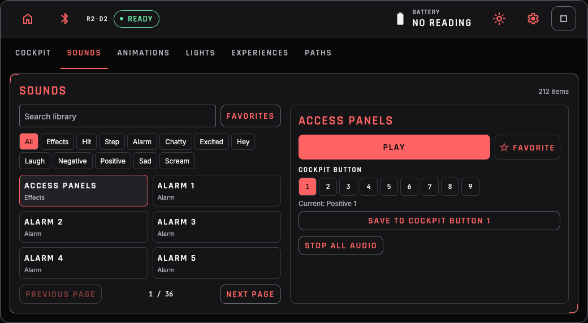
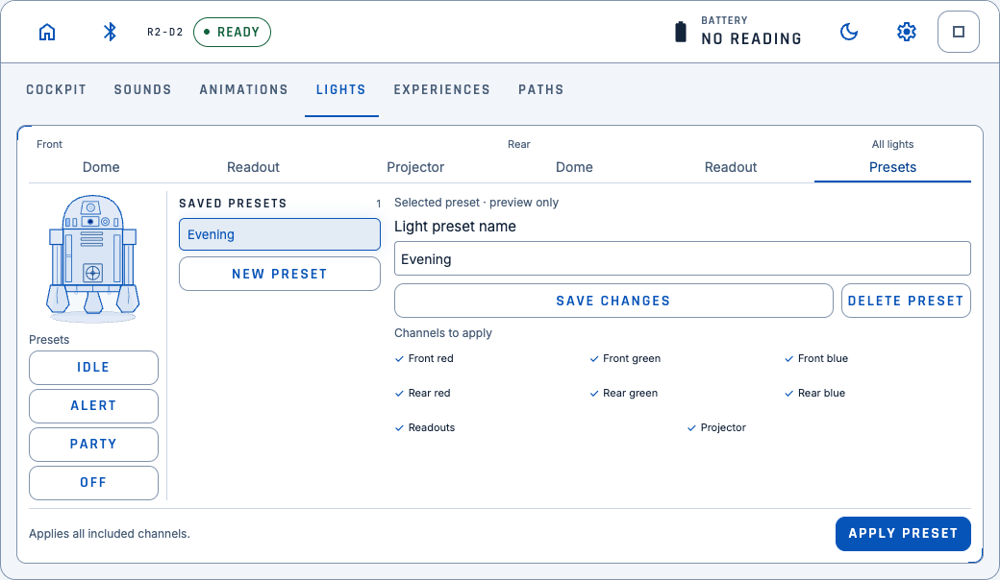

# Mech

Control Sphero’s R2-D2 from Home Assistant’s sidebar panel and use its sounds
and lights in your automations.

## Installation

With HACS installed and Bluetooth configured to reach your droid, sign in to
Home Assistant 2026.11 or newer as an administrator and add Mech:

<!-- hacs-install-start -->

1. In **HACS → Custom repositories**, add
   `https://github.com/swishyswoosh/mech-hacs` with category **Integration**.
2. Download **Mech Droid Controller** and restart Home Assistant.
3. Open **Settings → Devices & services → Add integration → Mech Droid Controller**
   and enter the droid’s Bluetooth address and name.
4. Disconnect the droid from any other controller, then open **Mech** in the
   sidebar and select **Connect**.

<!-- hacs-install-end -->

For manual installation, extract the contents of
[`mech.zip`](https://github.com/swishyswoosh/mech-hacs/releases/latest/download/mech.zip)
into `custom_components/mech/` in the Home Assistant configuration directory,
then restart Home Assistant and continue at step 3.

## Using the controller

In **Sounds**, search R2-D2's built-in library, select a sound and choose **Play**.
Use **Lights** to adjust colors and brightness; to keep a combination, open
**Presets**, choose **New preset**, enter a name and select **Save preset**.
You can also create light-only sequences in **Experiences → Protocols**.

Open **Drive** for the joystick and dome dial, or **Animations** to choose one
of the droid's built-in animations.

Home Assistant automations can play a sound when the doorbell rings or change
the lights for a notification, even while the panel is closed. Automations are
limited to sounds and lights, and saved paths are unavailable in this integration.

## Connection and maintenance

Keep the Mech panel active while driving or playing an animation, since
switching tabs or apps stops the current activity while keeping Bluetooth
connected. If a wheel stop fails, driving stays disabled until a successful
STOP, while the dome, stance, sounds and lights remain available.

Stop any activity before updating Mech through HACS and restarting Home
Assistant. To uninstall it, remove the integration from **Settings → Devices &
services**, remove its HACS download and restart Home Assistant.

[Releases](https://github.com/swishyswoosh/mech-hacs/releases) ·
[Report an issue](https://github.com/swishyswoosh/mech-hacs/issues)

Mech is licensed under MIT. Bundled icons, fonts and dependencies retain their
own licenses and attribution notices; see [third-party notices](THIRD_PARTY_NOTICES.md).
